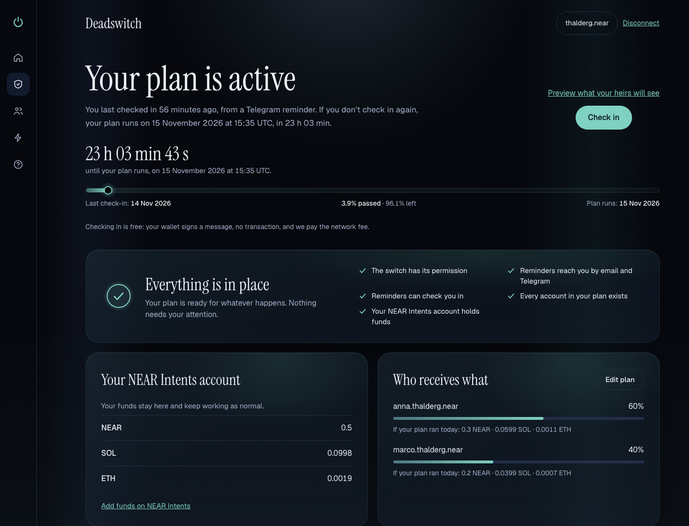
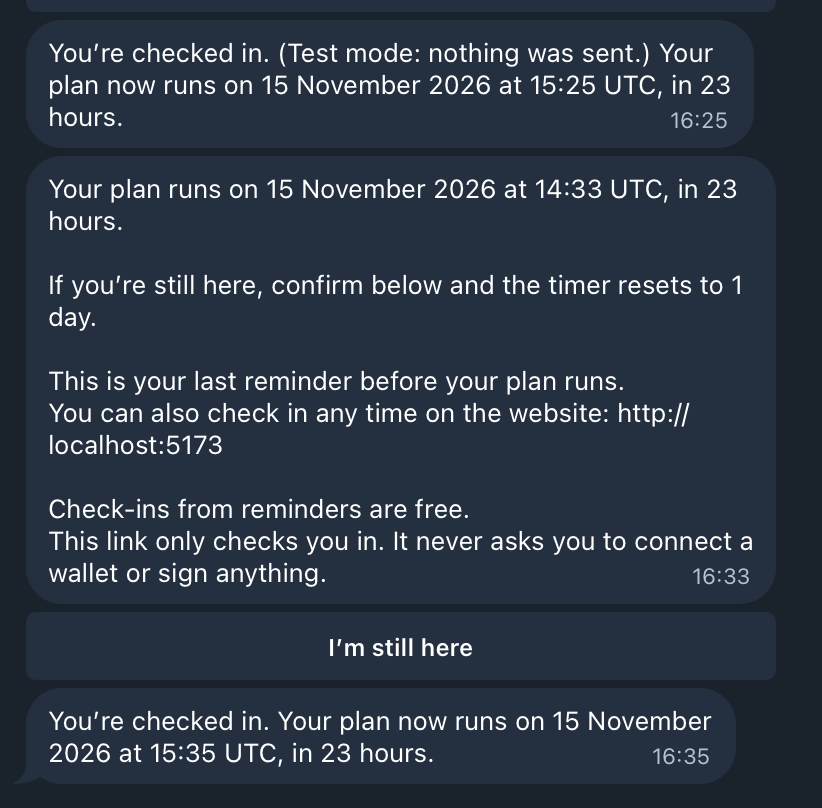
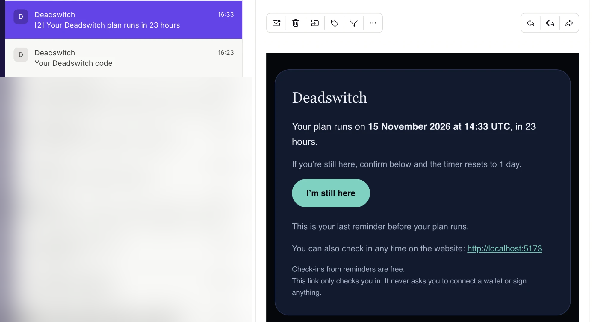
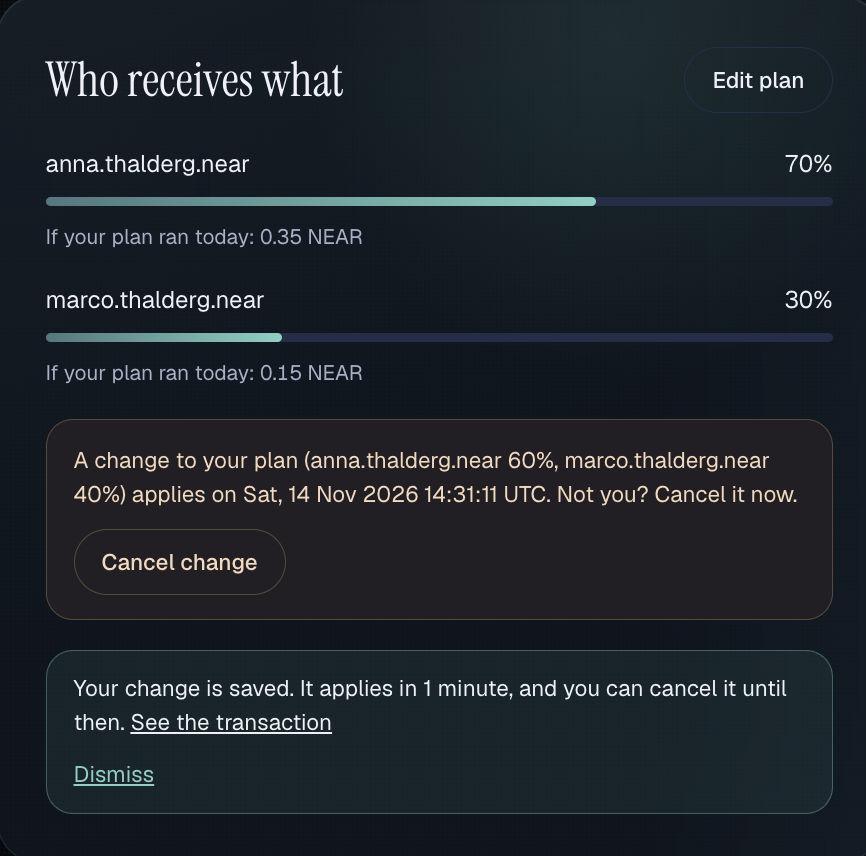
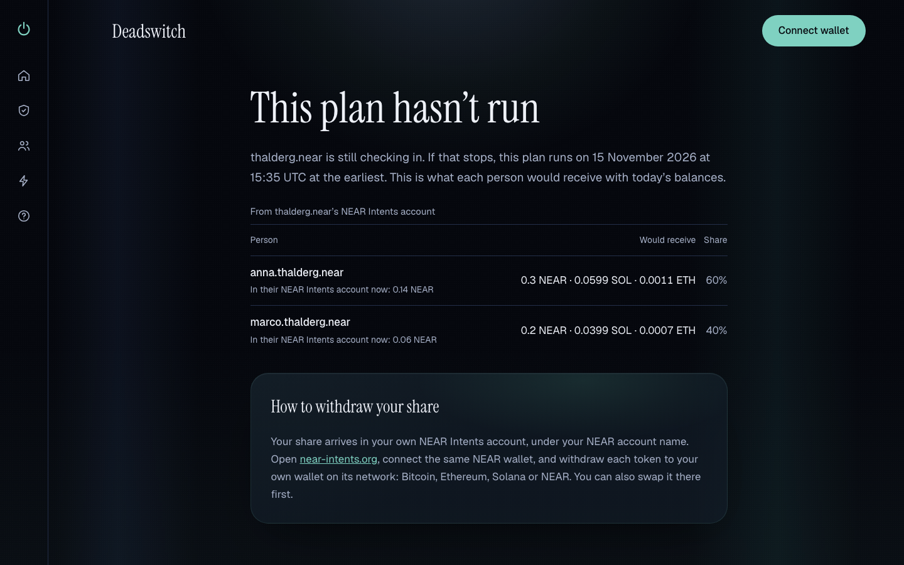
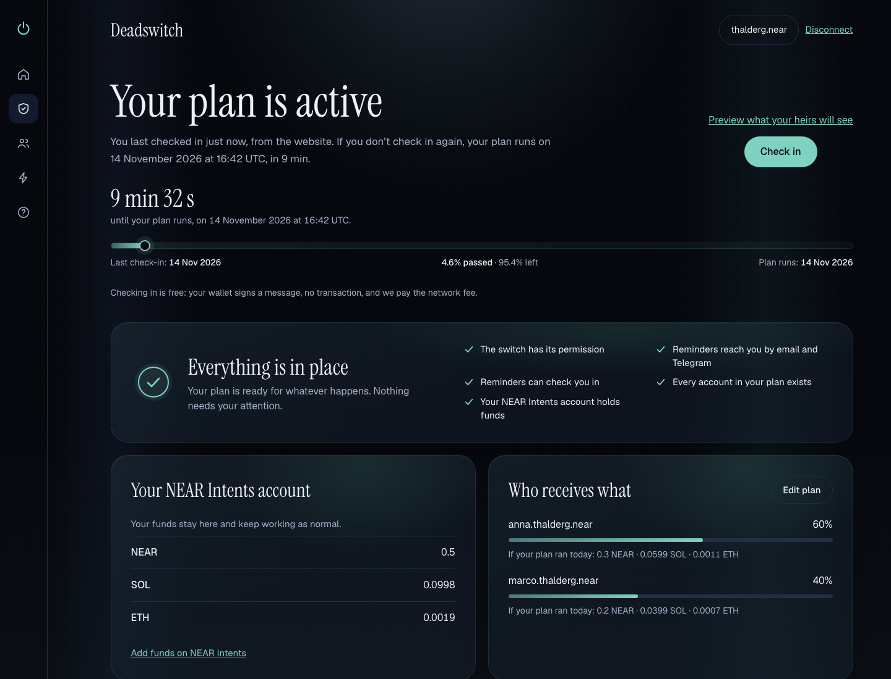
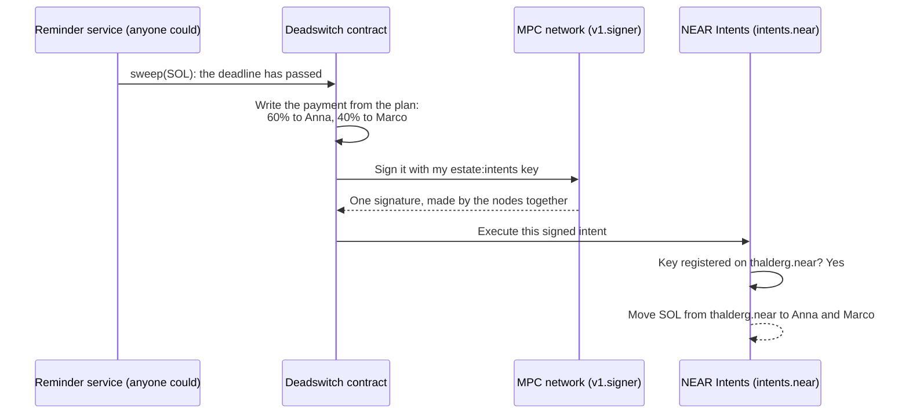
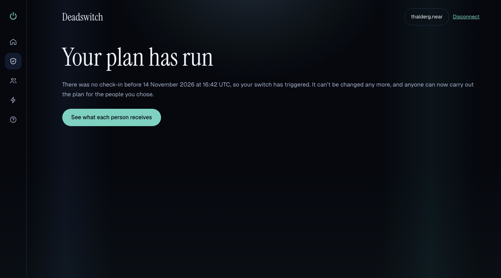
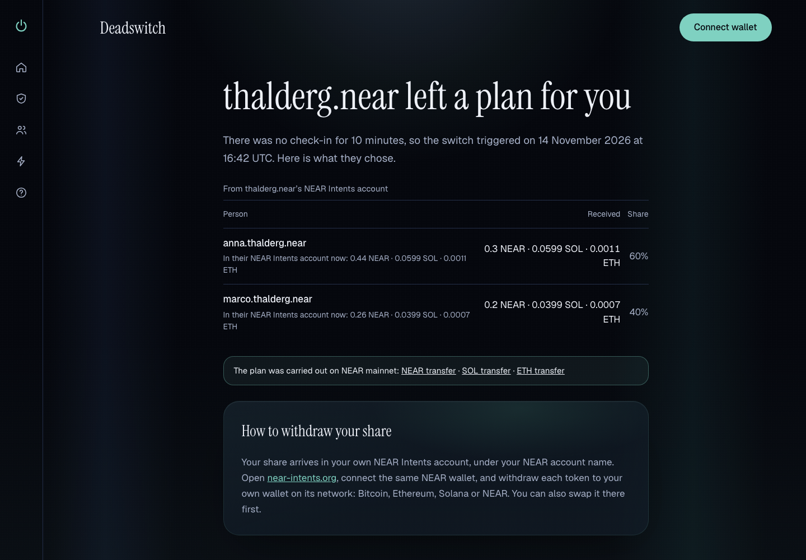
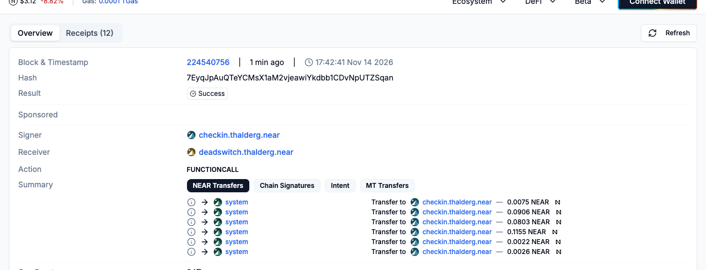

# Deadswitch demo: a real run on NEAR mainnet

A complete run of the plan, from setup to payout, on **NEAR mainnet**, with real funds and the real MPC network. Every step links to its transaction.

- Contract: `deadswitch.thalderg.near` (v5) · Owner: `thalderg.near`
- People in the plan: `anna.thalderg.near` 60%, `marco.thalderg.near` 40%
- Check-in operator (the reminder service): `checkin.thalderg.near`
- Funds, in the owner's own NEAR Intents account: 0.5 NEAR (wNEAR), 0.0999 SOL, 0.00193 ETH

**Video (1:30, no sound, captions only):** [docs/demo/deadswitch-demo.mp4](docs/demo/deadswitch-demo.mp4)

---

## 1. The idea

Every coin you hold flows into one switch. From it grows your plan: the people you chose if you stop checking in, a backup wallet if you lose access to yours, and "sent to safety" if someone gets hold of your keys.

## 2. The owner's plan

The dashboard reads everything from the chain: the countdown and how much of the check-in period has passed, the health check, the owner's NEAR Intents balance (NEAR, SOL and ETH, deposited through the NEAR Intents bridge), and who receives what, with what each person would get today.

## 3. Reminders check you in with one tap

Before the timer runs out, a reminder arrives by Telegram and email. Tapping **I'm still here** needs no wallet, no signature and no fee: the reminder service calls `operator_check_in` from `checkin.thalderg.near`, which pays the gas and can do nothing but reset the timer. One of these taps on mainnet: [DhutyWBr…](https://www.nearblocks.io/txns/DhutyWBrFoRWZYB8PSGqg5ahS1eXBpFeEsVp5PEFk7pV).

| Telegram | Email |
| --- | --- |
|  |  |

## 4. Changes that add power wait

A new split first appears as pending, with **Cancel change**; turning something off applies at once. The change delay is 1 minute in this test deployment and 48 hours in real use.

## 5. Before: what the people in the plan see

The page for the people in the plan shows what each would receive with today's balances, and what their own NEAR Intents accounts hold right now: Anna 0.14 NEAR, Marco 0.06 NEAR (from earlier tests).

## 6. The timer: 10 minutes, then nobody checks in

For the demo the owner sets the check-in period to 10 minutes ([set_timeout](https://www.nearblocks.io/txns/9KgkMLzuLLDLypG4KkCQ5i8Y9iBaYogT4sHWp4jkJvj8)). Then nobody answers the reminders.

## 7. Ten minutes later: the plan runs by itself

At the deadline the switch triggers and becomes final. The reminder service calls `sweep` once per asset. For each one, the contract writes a single transfer intent paying each person their share straight from the owner's NEAR Intents account, has it signed by NEAR's MPC network (`v1.signer`) with the estate key nobody holds, and submits it to `intents.near`. Nothing passes through the contract.

It started at 16:42:30 UTC and took 30 seconds for all three assets:

| Asset | Sent | Anna (60%) | Marco (40%) | Transaction |
| --- | --- | --- | --- | --- |
| NEAR (wNEAR) | 0.5 | 0.3 | 0.2 | [HHve3tCY…](https://www.nearblocks.io/txns/HHve3tCYr7e8x8ccMUmQKkAFmtHo3hKN452td8EeKpRv) |
| SOL | 0.0999 | 0.0599 | 0.0399 | [7EyqJpAu…](https://www.nearblocks.io/txns/7EyqJpAuQTeYCMsX1aM2vjeawiYkdbb1CDvNpUTZSqan) |
| ETH | 0.00193 | 0.00116 | 0.00077 | [8DiJu7W9…](https://www.nearblocks.io/txns/8DiJu7W973Vi6yePfkzH2RjuvtHTBn4ngZeKeoSJmYto) |

The owner's wallet signed none of these, and nobody holds the key that did.

**What happened in those seconds, for each asset:**

1. The service asks the contract to carry out the plan for one asset. It can't choose where the money goes.
2. The contract writes the payment itself, from the plan, with a one-time nonce and a one-hour expiry.
3. NEAR's MPC network signs it with the contract's estate key. No single node can sign alone, and the full key never exists anywhere.
4. NEAR Intents sees a valid signature from a key the owner registered, and moves the balances inside its ledger: NEAR, SOL and ETH all work the same way. More detail: [Under the hood](README.md#under-the-hood-how-your-crypto-moves-without-your-signature).

## 8. After: Anna and Marco received their shares

Each person's share is now in their own NEAR Intents account, ready to withdraw to their own wallet on that asset's network: Anna went from 0.14 to 0.44 NEAR plus 0.0599 SOL and 0.00116 ETH; Marco from 0.06 to 0.26 NEAR plus 0.0399 SOL and 0.00077 ETH. Both got an email saying the plan had run. The page links to every transfer.

The SOL sweep in a NEAR explorer: a success, with the Chain Signatures, Intent and multi-token transfer steps ([open it](https://pikespeak.ai/transaction-viewer/7EyqJpAuQTeYCMsX1aM2vjeawiYkdbb1CDvNpUTZSqan)).

## What this shows

- Funds never left the owner's account until the moment they moved, and then only to the accounts in the plan.
- The key that moved them is held by nobody: only the MPC network signs with it, and only when the contract's rules allow.
- Checking in is free and takes one tap; the service that does it can only reset the timer.
- It works for any asset held in NEAR Intents: here NEAR, Solana and Ethereum.

## What's next

- **Confidential by default.** near.com now keeps balances confidential by default (NEAR Confidential Intents, `intents.far`). Today the switch protects only the public NEAR Intents account; next, it protects confidential balances by default and pays out confidentially, so nobody can see what you hold or who inherited what.
- **A real testament, per asset and amount:** "Anna gets the BTC, Marco 2,000 USDC, the rest to a charity", instead of one percentage split for everything.
- **A private testament:** only a hash on-chain; the plan itself unlocked only when the switch triggers, and executed in a secure enclave that proves it matches.
- **Delivery straight to an heir's own wallet** on Bitcoin, Ethereum or Solana, and **converting at payout**, since NEAR Intents can swap.
- **Drafting the plan from plain words** with a private NEAR AI model, always confirmed by the owner.
- **Add funds from the dashboard**, more reminder channels (Discord, SMS), one contract for many owners, and a locked deployment nobody can change.

A prototype, not a legal will.
