# Deadswitch: a plan for your crypto, on NEAR Intents

*Built at NEAR HACKATHON. @NEARProtocol #NEARHackathon*

In crypto, your capital is at risk every day.

- **Stolen:** more than **$13 billion** was taken in crypto hacks and exploits from 2021 to 2025, according to Chainalysis: over $3 billion in each of 2021 and 2022, $2.2 billion in 2024, and more than $3.4 billion in 2025, $1.5 billion of it in the Bybit hack alone.
- **Lost:** an estimated **2.3 to 3.7 million bitcoin**, out of 21 million ever, are permanently out of reach because keys or seed phrases were lost, forgotten or died with their owner (a Chainalysis estimate, as reported by Ledger Academy). At $100,000 per bitcoin, that is $230 to $370 billion.

The usual fixes are sharing a seed phrase with family or trusting a custodian.

**Deadswitch needs neither, and your funds never leave your account. It gives your crypto a plan: peace of mind now, and an impact that outlasts you.**

| While you're here | When you're gone |
| --- | --- |
| Use your funds as you always do. Trading, swapping and withdrawing keep working. | Everything goes where you want it to go: family, friends, or a cause you care about. |
| Reminders arrive by email or Telegram, timed to your plan. One tap checks you in: no wallet, no fees. | Each person receives their share in their own account, ready to withdraw to their own wallet. |
| If your keys are ever at risk, one button moves everything to safety. | Your crypto keeps doing good after you, instead of being lost forever. |

**How:**

- You keep your crypto in **your own NEAR Intents account**, fully available: trade, swap and withdraw whenever you want.
- You give the switch **one permission**: an extra key on your Intents account that **nobody holds**. Only NEAR's MPC network can sign with it, and only when the Deadswitch contract asks.
- **If you stop checking in**, your plan is carried out: each person you chose receives their share, straight from your account.
- **If your keys are at risk**, a panic button sends everything to the people in your plan immediately.
- **We remind you** by email or Telegram before your timer runs out. One tap checks you in: no wallet, no fees.

**[See the full demo on NEAR mainnet →](DEMO.md)**: a real run where nobody checked in and the switch sent NEAR, SOL and ETH to the people in the plan by itself, with every transaction linked and a 105-second captioned video.

*Sources: [Chainalysis, 2025 theft report](https://www.chainalysis.com/blog/crypto-hacking-stolen-funds-2026/) · [Chainalysis, 2024 theft report](https://www.chainalysis.com/blog/crypto-hacking-stolen-funds-2025/) · [Ledger Academy, how many bitcoin are lost](https://www.ledger.com/academy/topics/economics-and-regulation/how-many-bitcoin-are-lost-ledger).*

> A hackathon prototype, not a legal will.

---

## What it covers

Everything you hold in your NEAR Intents account. NEAR Intents holds real assets from many networks, so this includes NEAR (held as wNEAR, 1:1), BTC, ETH, SOL, USDC and other supported tokens, including yield-bearing tokens such as liquid staking tokens if Intents lists them.

Each person in the plan receives their share in their own Intents account and can withdraw it to their own wallet on that asset's network.

Deadswitch is built for **NEAR Intents only**, by design.

---

## How it works

1. **Protect.** You register the switch's key on your own Intents account (`add_public_key` on `intents.near`). NEAR Chain Signatures derive it from the Deadswitch contract's account and the fixed path `estate:intents`, so its private half never exists anywhere. Your funds don't move.
2. **Plan.** You choose who receives what, in percentages (the testament).
3. **Check in.** Either connect your wallet on the website and press **Check in**, or tap **I'm still here** in an email or Telegram reminder.
4. **If you stop checking in,** the timer runs out and the switch is **final**: you're locked out (this protects your heirs if your key is stolen after your death), and anyone can carry out the plan with `sweep`.
5. **Sweep.** The contract writes **one fixed intent** paying each heir their share straight from your Intents account, has the MPC network sign it, and submits it to `intents.near`. The contract writes the destinations itself from the testament, so nobody can redirect the funds. Nothing passes through the contract.

### Safety rules

- **No one holds the key.** The MPC network splits it across independent operators; a threshold must cooperate to sign, and the whole key never exists in one place.
- **Only the contract can use it.** Chain Signatures derive keys from the account that requests the signature: the Deadswitch contract, whose code decides when the key may sign.
- **The key only works inside NEAR Intents.** It can't touch your NEAR account or any wallet.
- **Changes that add power wait; changes that remove power are immediate.** Changing your testament, turning a feature on, or allowing a check-in operator waits for a change delay fixed at deploy (48 hours in real use). Turning a feature off or removing the operator applies at once. So someone holding your key can't quickly redirect your plan, and you have time to cancel.

### Three modes

Set at deploy and changeable later (off at once, on after the change delay):

| Mode | What it does |
| --- | --- |
| Timer only | Your plan runs if you stop checking in |
| Timer + panic button | Plus: you can send everything to your plan at any time |
| Panic button only | No timer; only you can send, whenever you decide |

---

## Under the hood: how your crypto moves without your signature

This is what makes Deadswitch possible, and it shows what NEAR Intents and Chain Signatures can do together: **a contract moves many kinds of crypto, from many blockchains, out of your own account, without you signing anything and without anyone holding the key.**

### The pieces

| Piece | What it is | In plain words |
| --- | --- | --- |
| **NEAR Intents** (`intents.near`) | One ledger that holds assets from many chains: BTC, ETH, SOL, USDC, NEAR… | A single account where all your crypto sits side by side, whatever chain it came from. |
| **Your Intents account** (`thalderg.near`) | Your balances in that ledger, controlled by the keys you register | Your funds. They stay here until the moment they move. |
| **Chain Signatures** (the MPC network, `v1.signer`) | Independent nodes that sign together; the full key never exists in one place | A safe that needs many keyholders to turn their keys at once, and only opens for the contract that owns that drawer. |
| **The estate key** | A key derived for `deadswitch.thalderg.near` with the path `estate:intents` | A key nobody has: only the MPC network can sign with it, and only when the contract asks. |
| **The Deadswitch contract** | The rules: timer, who receives what, panic button, change delay | The judge that decides *if* and *where* the funds may move. |

### Setting it up (once)

1. **The contract gets its key.** The MPC network derives a public key from the contract's account name and the path `estate:intents`: here `ed25519:DDLPgZdq…aRJRSZc`. The private half is never assembled anywhere.
2. **You give it one permission.** You add that public key to your own Intents account (`add_public_key` on `intents.near`). It's like adding a co-signer who can only act through the contract's rules. Your funds don't move, and you can remove the key any time.
3. **You write the plan.** Who receives what, in the contract. Changes that add power wait 48 hours and can be cancelled.

### When the plan runs (a few seconds)

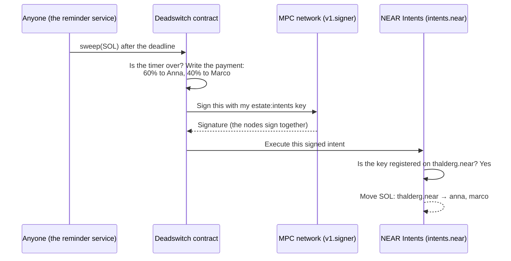

1. **Someone calls `sweep`.** Anyone can, once the deadline has passed; the reminder service does it automatically. The caller only chooses *which* asset; it can't choose *where* it goes.
2. **The contract writes the payment itself.** One transfer intent: "from `thalderg.near`, pay 60% to `anna.thalderg.near` and 40% to `marco.thalderg.near`", valid for one hour, with a one-time nonce so it can never be replayed. The destinations come only from the plan.
3. **The MPC network signs it.** The contract asks `v1.signer` to sign with its `estate:intents` key. The independent nodes produce one signature together; no single node can sign alone.
4. **NEAR Intents checks and moves the funds.** `intents.near` sees a valid signature from a key registered on your account and moves the balances inside its ledger, straight from your account to theirs. Nothing passes through the contract.
5. **Repeat per asset.** NEAR, SOL and ETH are each one call, and they all work the same way, because in NEAR Intents they're all just balances in one ledger. No gas on Bitcoin, Ethereum or Solana is needed at that moment; each person can withdraw to their own wallet on that chain later.

### Why this matters

- **No one holds your keys, and no one has to.** Not us, not your family, not a custodian.
- **The rules are code.** The key can only be used by the contract, and the contract only pays the accounts in your plan.
- **Many chains, one switch.** Everything you hold in NEAR Intents is covered by one permission and one plan.
- **Your wallet never signs the payout.** That's the point: it has to work when you can't sign anymore.

---

## Check-ins and reminders

**How you check in**

- **On the website:** connect your wallet, then press **Check in**. Signing in alone doesn't check you in.
- **From a reminder:** tap **I'm still here** in an email or a Telegram message. No wallet, no signature, no fee.

**How a one-tap check-in works:** the owner allows a **check-in operator** (the Deadswitch reminder service) in the contract. When you tap a reminder, the service confirms it came from your linked email or Telegram, then calls `operator_check_in`. The operator:

- **pays its own gas**, so check-ins cost you nothing,
- **can only reset your timer**: it can't move funds, change your plan or act as you,
- is limited to **one check-in per interval** (24 hours in real use), so a faulty or compromised service can't spam,
- can never bring back a switch that has already triggered,
- can be removed by you at any time, with immediate effect.

The worst a compromised operator could do is delay your plan.

**Reminder schedule** (one rule based on time left, for any timer length):

| Time left | Reminders |
| --- | --- |
| More than 30 days | once a month |
| 30 to 7 days | once a week |
| 7 to 2 days | every 2 days |
| Last 2 days | once a day |

Each reminder shows how much time is left, the exact date and time the plan runs, when its link expires (at the next reminder), when the next reminder arrives, and a link to check in on the website. Real check-in links never ask you to connect a wallet or sign anything.

**Optional:** the people in your plan can be notified by email or Telegram when the plan runs, with what they received and how to withdraw it. Contact details are stored by the service, never on-chain.

---

## See it working

All screenshots are from the live prototype on NEAR mainnet (`deadswitch.thalderg.near`, owner `thalderg.near`).

**The landing page.** Each coin you hold is a loose wire; they all run into your switch, a seed in a pot shaped like the power symbol. A bonsai grows from it: one branch splits into the shares of the people you chose, one leads to a backup wallet, and a low one sends everything to safety if your keys are at risk.


**Your plan.** A live countdown and a bar showing how much of the check-in period has passed, a health check ("Everything is in place"), your NEAR Intents balance, who receives what (with what each person would get today), reminders, settings, the panic button and the switch's permission.

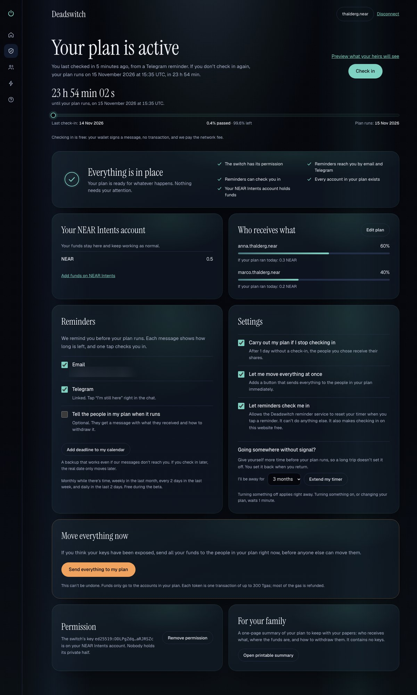

**Reminders that check you in with one tap.** By Telegram and by email. The tap needs no wallet and no signature: the reminder service calls `operator_check_in` and pays the gas. Here the Telegram tap reset the timer on mainnet ("You're checked in. Your plan now runs on 15 November 2026 at 15:35 UTC").

| Telegram | Email |
| --- | --- |
| 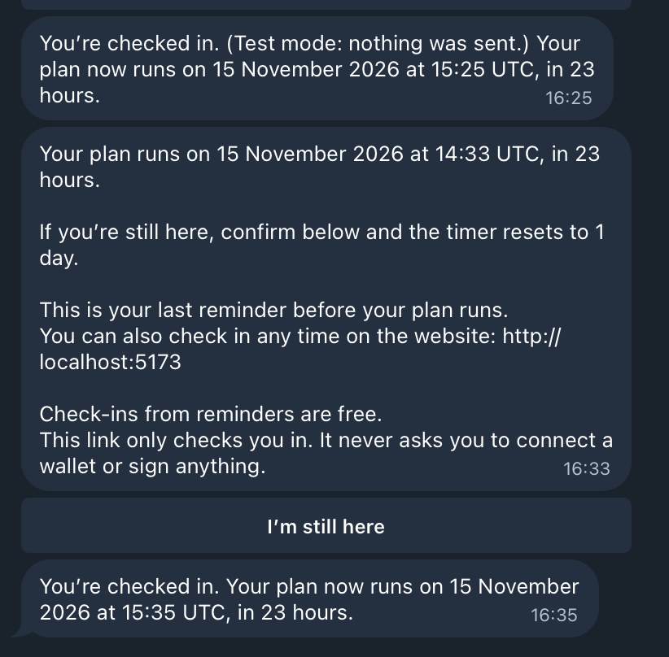 | 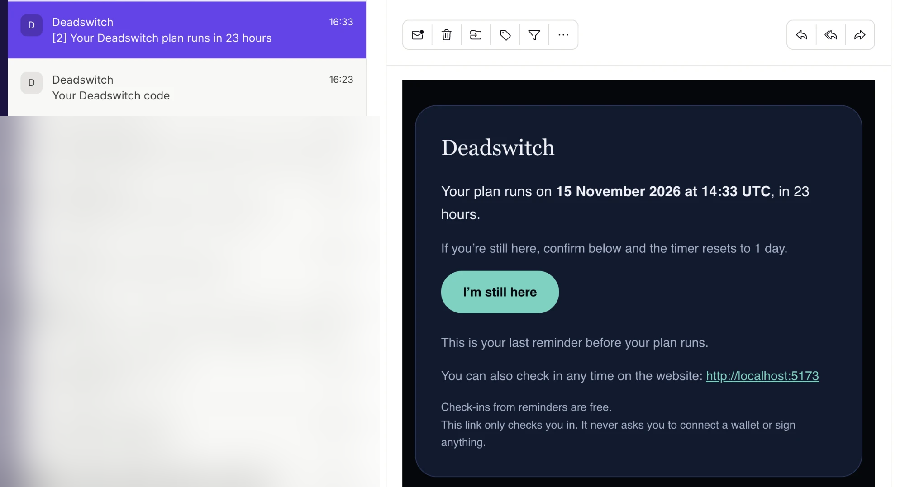 |

**Checking in on the website is free too.** The wallet signs a message (no transaction); the service verifies it and checks you in.

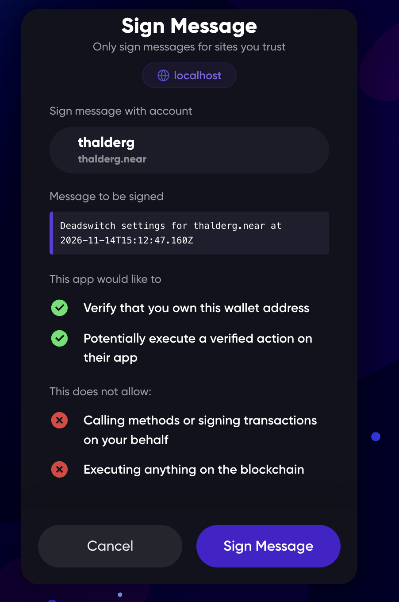

**Changes that add power wait; you can cancel them.** A new split (60/40) first appears as pending with a "Cancel change" button; cancelled, the plan stays as it was; saved again and left alone, it applies after the change delay (1 minute in this test deployment, 48 hours in real use).

| Pending | Cancelled | Applied |
| --- | --- | --- |
| 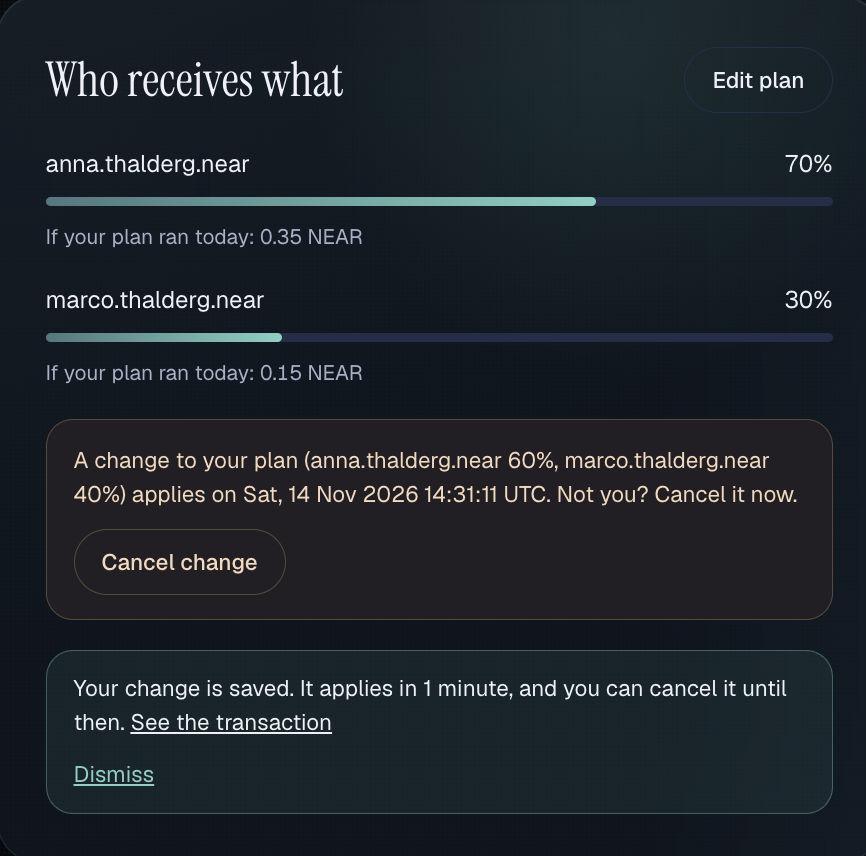 | 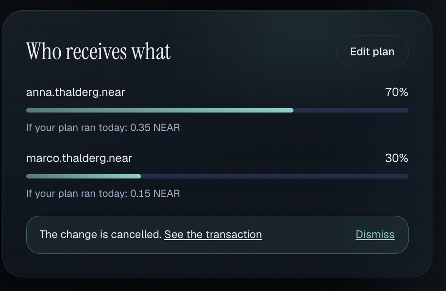 | 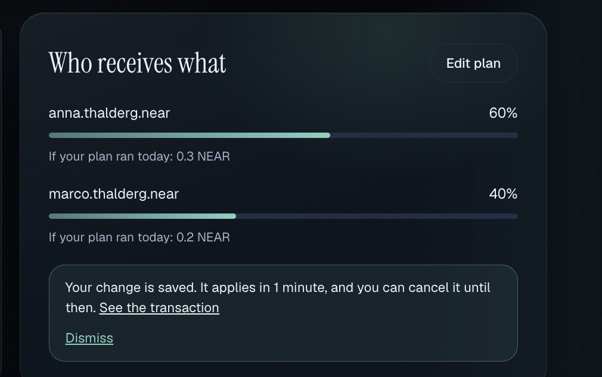 |

**Turning something off is immediate; turning it on waits.**

| Panic button off: applied at once | Turned back on: waits for the delay |
| --- | --- |
| 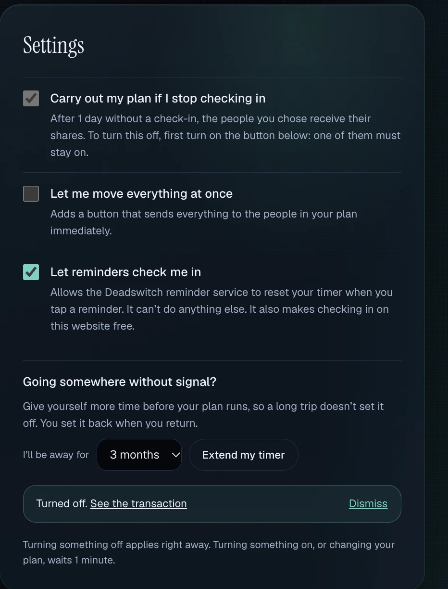 | 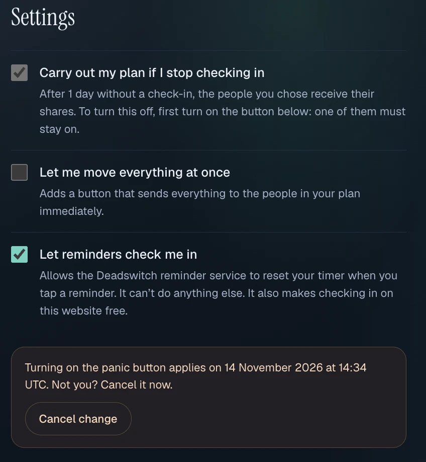 |

**What the people in the plan see.** Before the plan runs, what each would receive with today's balances; after, a **Carry out the plan** button and how to withdraw.

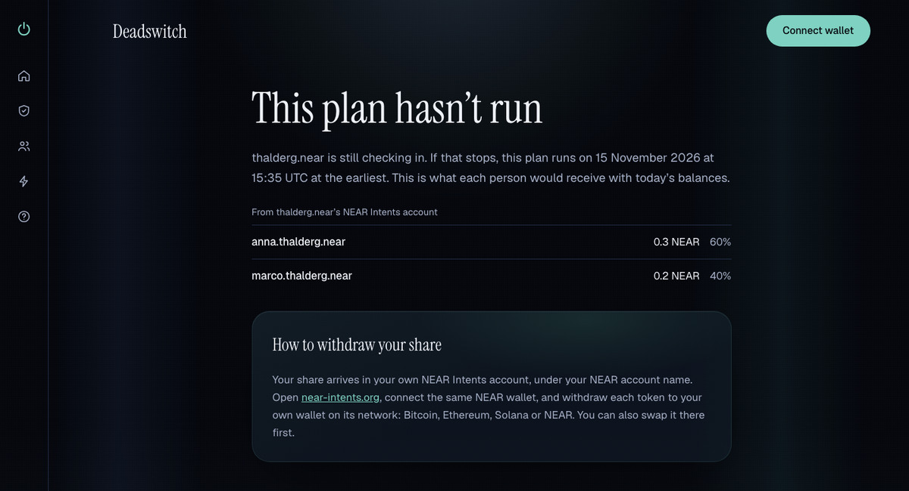

---

## Pricing and business model

**Free during the beta.** Nothing is charged in this prototype.

Planned:
- **Reminders subscription, about $10 a year,** paid in USDC or any NEAR Intents token (priced in dollars so it costs the same every year, whatever NEAR's price does). It covers email and Telegram reminders and free one-tap check-ins: the subscription tops up the check-in operator's account, which pays the gas.
- **Later: a small fee only when a plan is carried out**, a percentage of what's sent, written into the contract and shown before you sign up. Free while you're alive; earned only when the service does its job.

**Who pays for what**
- **The contract** only holds its storage deposit; it never pays for check-ins.
- **The check-in operator** pays the gas for every check-in (about 0.0003 NEAR each). Checking in from a reminder or on the website is free for you.
- **The website check-in** asks your wallet for a free signed message, not a transaction. Only if your wallet can't sign messages does the app fall back to a direct check-in from your wallet, which costs a fraction of a cent, and it tells you first.
- **Carrying out the plan** costs whoever triggers it about 0.01–0.03 NEAR; in the full service, the operator does it.

---

## The testament

**Today:** each person gets a percentage (basis points, adding up to 100%), applied to every token swept. Changes wait for the change delay and can be cancelled. A backup wallet of your own can be one of the "heirs", which turns the switch into recovery for a lost wallet.

**Next:**
- **Rules per asset and exact amounts**, for example "Anna gets the BTC, Marco 2,000 USDC, the rest to a charity", instead of one percentage split for everything.
- **Converting at payout**, since NEAR Intents can swap.
- **Delivery straight to an heir's own wallet** (Bitcoin, Ethereum, Solana) through NEAR Intents withdrawals, so heirs don't need a NEAR account.
- **Drafting from plain words** with a NEAR AI private model, confirmed by the owner. The AI never interprets the plan at payout time.
- **A private testament:** only a hash on-chain; the full plan encrypted with a key from NEAR's Confidential Key Derivation that only becomes available once the switch triggers, then executed in a secure enclave (TEE) that proves it matches the hash.

---

## Roadmap

- **Confidential by default.** near.com now keeps balances in NEAR's Confidential Intents by default (`intents.far`), where today's switch can't reach them: it only covers the public NEAR Intents account (`intents.near`), which near.com shows as a "legacy" asset. Next, Deadswitch protects confidential balances by default and pays out confidentially, so nobody can see what you hold or who inherited what. Together with the private testament, neither the rules nor the payouts are public.
- **Add funds from the dashboard:** the plan account's Bitcoin, Ethereum and Solana deposit addresses, with pending deposits, so owners never have to find them elsewhere.
- **Reminders:** Discord and SMS next to email and Telegram.
- **Execution fee** as described in the business model.
- **One contract for many owners**, each with their own settings and estate key (path `estate:<owner>`), instead of one contract per owner.
- **Self-funded check-ins:** an optional capped deposit in your own switch that repays the operator per check-in, for people who'd rather not rely on the subscription.
- **Locked deployment:** deleting the contract's full-access keys so nobody can ever change the code.
- **Yield-bearing tokens** in the plan, so funds keep earning until they move.

---

## Contract API (v5)

| Function | Who | When | What it does |
| --- | --- | --- | --- |
| `new(owner, timeout_secs, heirs, mpc_contract, intents_contract, timer_enabled, panic_enabled, change_delay_secs, operator_min_interval_secs)` | contract account | once | Initialises the switch |
| `ping()` | owner | before trigger | Check in |
| `set_testament(shares)` / `set_heirs(heirs)` | owner | before trigger | New plan, after the change delay |
| `cancel_pending_testament()` | owner | before trigger | Cancels a waiting change |
| `set_modes(timer_enabled, panic_enabled)` | owner | before trigger | Off at once, on after the delay |
| `cancel_pending_modes()` | owner | before trigger | Cancels a waiting mode change |
| `set_checkin_operator(account_id)` | owner | before trigger | Allows an operator, after the delay |
| `remove_checkin_operator()` | owner | before trigger | Removes it at once |
| `operator_check_in()` | operator | before trigger | Resets the timer; once per interval |
| `set_timeout(timeout_secs)` | owner | before trigger | Changes the check-in period |
| `set_estate_key(public_key)` | owner | before trigger | Records the key registered on Intents |
| `send_now(token_id, amount, salt)` | owner | panic button on | Executes the plan now |
| `sweep(token_id, amount, salt)` | anyone | after trigger | Executes the plan |
| `status()`, `preview_sweep(amount)`, `swept(token_id)` | anyone (views) | any time | State, payout preview, totals |

`salt` is the current salt of NEAR Intents (`current_salt` on `intents.near`). Attach 300 Tgas to `sweep` and `send_now`.

---

## Proof: tests on NEAR mainnet

All against the real MPC network (`v1.signer`) and the real NEAR Intents (`intents.near`), contract `deadswitch.thalderg.near`, owner `thalderg.near`.

**1. The key mechanism.** An intent signed through the contract, with a key nobody holds, moved 0.1 wNEAR out of the owner's own Intents account ([transaction](https://www.nearblocks.io/txns/7tQshpxGasARiJDf3L1eegPXnn9tLED35pi41jtCYfyw)):
```
EVENT_JSON:{"standard":"nep245","event":"mt_transfer","data":[{"old_owner_id":"thalderg.near",
  "new_owner_id":"deadswitch.thalderg.near","token_ids":["nep141:wrap.near"],"amounts":["100000000000000000000000"]}]}
```

**2. Sweep after the deadline (v2).** The heir `anna.thalderg.near` triggered the sweep; 0.1 wNEAR was paid from the owner's account per the testament, 0.07 to Anna and 0.03 to Marco. [add transaction link]

**3. Owner lockout.** After the timer ran out, the owner's `set_testament` and `set_estate_key` were refused, and `status` showed:
```
triggered: true
```

**4. Change delay (v3).** A new testament (70/30) first appeared as pending, then took effect after 60 seconds:
```
pending_testament: { heirs: [ anna 7000, marco 3000 ], effective_ns: '1794580230369834068' }
...after 60 s:
preview_sweep 0.1 wNEAR -> anna 70000000000000000000000, marco 30000000000000000000000
```

**5. Panic button (v3).** The owner executed the plan immediately with `send_now`. [add transaction link]

**6. Modes (v4).** Turning the panic button off applied at once (`send_now` then refused with `The panic button is off for this switch`); turning it back on waited for the change delay.

**7. Check-in operator (v5).** `checkin.thalderg.near` reset the timer, paying its own gas ([transaction](https://www.nearblocks.io/txns/6GJrL2zhDeaASViW7tCfE2aeYP25smYwAN59xNVQydew)):
```
last_ping_ns: '1794651995288825645'
deadline_ns: '1794738395288825645'
checkin_operator: 'checkin.thalderg.near'
last_operator_checkin_ns: '1794651995288825645'
```
A second check-in right after was refused:
```
Smart contract panicked: Too soon: the operator can check in at most once per interval
```

**8. One-tap check-in from a Telegram reminder (web app + reminder service).** The owner tapped "I'm still here" in Telegram; the service called `operator_check_in` from `checkin.thalderg.near` and the timer reset, with no wallet and no fee for the owner ([transaction](https://www.nearblocks.io/txns/DhutyWBrFoRWZYB8PSGqg5ahS1eXBpFeEsVp5PEFk7pV)).

**Earlier, on testnet (v1):** the MPC network signed for the contract ([8B7SJxyp…](https://testnet.nearblocks.io/txns/8B7SJxypdFyoFfZmZhLotzgUXv1Ug1R6PGUjuTYUCTnQ)), an heir signed after the deadline ([GJhRaWzs…](https://testnet.nearblocks.io/txns/GJhRaWzs346zxcNwrkb2gJa4iWBkqubTijW6s1qJJVCa)), and the expected refusals and an Ed25519 signature followed.

**Unit tests:** 50, covering the timer, owner lockout, testament and change delay, modes, panic button, sweep rules, the check-in operator, and the exact intent format (including a real mainnet signature as a test vector).

---

## How it evolved

Each version is archived in `history/` and tagged in Git (`v1` to `v5`).

| Version | What it did | Why it changed |
| --- | --- | --- |
| v1 | Vault in the contract; per-heir ETH and SOL addresses through Chain Signatures | Nobody wants to move savings into a contract while alive |
| v2 | Funds stay in the owner's Intents account; the contract signs one intent paying heirs directly | The core design |
| v3 | Panic button, change delay | Emergencies and protection against coercion |
| v4 | Switch modes on and off | Owners change their minds |
| v5 | Check-in operator | Check-ins from email and Telegram, with no wallet and no fees |

---

## Run it yourself

Requirements: Rust, [`cargo-near`](https://github.com/near/cargo-near), [NEAR CLI](https://github.com/near/near-cli), a NEAR mainnet account with a small amount of wNEAR in NEAR Intents (Intents has no testnet).

```bash
cargo test
cargo near build non-reproducible-wasm

near deploy <contract>.near target/near/deadswitch.wasm --initFunction new \
  --initArgs '{"owner":"<owner>.near","timeout_secs":86400,"heirs":["<heir1>.near","<heir2>.near"],"mpc_contract":"v1.signer","intents_contract":"intents.near","timer_enabled":true,"panic_enabled":true,"change_delay_secs":60,"operator_min_interval_secs":60}' \
  --networkId mainnet

# The estate key: register it on your Intents account, then record it in the contract
KEY=$(near view v1.signer derived_public_key '{"path":"estate:intents","predecessor":"<contract>.near","domain_id":1}' --networkId mainnet | tail -1 | tr -d "'\"")
near call intents.near add_public_key "{\"public_key\":\"$KEY\"}" --depositYocto 1 --useAccount <owner>.near --networkId mainnet
near call <contract>.near set_estate_key "{\"public_key\":\"$KEY\"}" --useAccount <owner>.near --networkId mainnet

# After the deadline, anyone can carry out the plan
SALT=$(near view intents.near current_salt '{}' --networkId mainnet | tail -1 | tr -d "'\"")
near call <contract>.near sweep "{\"token_id\":\"nep141:wrap.near\",\"amount\":\"100000000000000000000000\",\"salt\":\"$SALT\"}" \
  --useAccount <anyone>.near --gas 300000000000000 --networkId mainnet
```

`scripts/intents-key-test.mjs` reproduces the key-mechanism test by hand.

---

## Status

- [x] Contract v5: timer, owner lockout, testament with change delay, modes, panic button, check-in operator, sweep through an MPC-signed intent
- [x] 50 unit tests
- [x] Tested on NEAR mainnet with the real MPC network and NEAR Intents
- [x] Web app: setup, plan, Check in button, panic button, heir view
- [x] Reminder service: email and Telegram, one-tap check-ins, automatic sweep, optional messages to heirs
- [ ] Demo with a real non-NEAR asset (SOL or ETH) held in Intents

## Known limitations

- Someone holding your NEAR key can still move funds out of your Intents account directly, around the contract. The panic button helps you win that race; the change delay protects your plan, not the account itself.
- The reminder service is part of what keeps the plan from running early for someone who never transacts. That's why reminders escalate near the deadline and use several channels.
- The caller of `sweep` chooses the amount per token (read from the owner's balance); a partial amount can be swept again.
- One contract per owner in this prototype.
